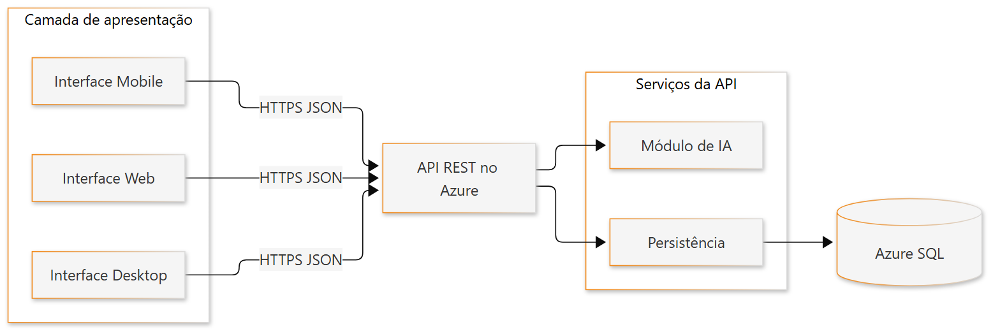

# Diagrama de estrutura — Sprint 8

| Arquivo | Descrição |
|---------|-----------|
| `Estrutura.png` | Componentes: interfaces → API REST → IA e persistência → Azure SQL |

  
<b>Diagrama de estrutura</b>

   
  

